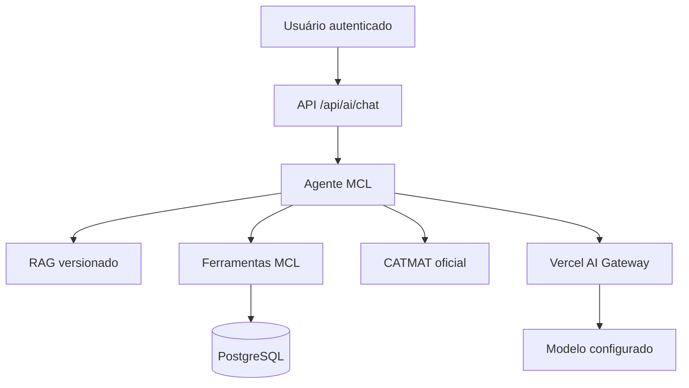

# Cognitive Core v1.0 — manual de manutenção (MVP Créditos/TG)

**Situação:** implementação experimental do registro semântico e planejador LLM. Não declarar prontidão do clipe antes de CI, deploy e interação real autenticada. Documentação visível no Guia Técnico, seção Agente LLM com RAG. Linear: EDE-32 hoje; EDE-31 evolução; EDE-33 atualização TG.

## Correção de robustez e perguntas sobre a origem de um valor (17/10/2026)

- O planejamento semântico usa por padrão o modelo não-raciocinante `openai/gpt-4.1-mini` via Vercel AI Gateway. A variável opcional `MCL_AI_PLANNER_MODEL` permite configurá-lo; o modelo conversacional (por padrão `openai/gpt-5-mini`) permanece para análises abertas e retentativa do planejamento.
- O teto anterior de 420 tokens poderia gerar `AI_NoOutputGeneratedError` na produção. Agora a saída estruturada dispõe de 1.024 tokens; quando o modelo produz saída vazia ou objeto inválido, ocorre uma única retentativa com o modelo conversacional e 2.048 tokens. Erros de autenticação, quota e indisponibilidade não recebem retentativa cega.
- Após duas saídas vazias, a resposta informa `AI_SEMANTIC_PLAN_EMPTY`, nunca resultado inventado. Esse tratamento é de engenharia defensiva, não prova de que o serviço remoto responde bem.
- O contrato semântico inclui `intent=source` para perguntas sobre qual UG/UASG originou o valor anterior. O núcleo recupera a UG da última resposta efetivamente exibida, consulta novamente o TG autorizado e expõe o nome da UG, a distinção de escopo e a proveniência, sem reproduzir o valor como se fosse outra consulta.
- A interface exclui mensagens de erro do histórico do LLM, preservando o contexto válido da última resposta.
- A execução real do Gateway, sua quota e a taxa de sucesso ainda dependem de validação autenticada. O acesso aos logs Vercel dessa conta esteve negado com HTTP 403 durante a investigação.

## Contrato de execução

1. A rota /api/ai/chat autentica, verifica autorização e limite por usuário.
2. O SDK AI Gateway gera em uma chamada um plano validado por Zod (não uma cadeia de palavras-chave) conforme src/modules/ai/semantic-registry.ts. Entrada: pergunta e histórico recente.
3. Catálogo semântico descreve entidades, medidas, agrupamentos, permissões, ferramenta e origem de cada domínio habilitado. MVP: somente credits-tg.
4. src/modules/ai/cognitive-core.ts valida plano e escopo. UASG da própria OM vem do vínculo da organização autenticada; ausência do vínculo impede falsa consulta agregada. Uma unidade explícita é filtrada somente dentro do snapshot autorizado.
5. src/modules/ai/silos.ts consulta a projeção TG persistida no banco. O executor financeiro calcula valores e percentuais em centavos. Denominador ausente/zero é reportado, não estimado.
6. A resposta indica arquivo, importação, fontes, lacunas e provedor de interpretação. Para perguntas abertas, o agente original continua como caminho separado; o RAG técnico atual é lexical, versionado e limitado.
7. Se o Gateway estiver indisponível, o sistema declara falha e só pode usar contingência determinística explicitamente marcada, sem fingir interpretação LLM.

## Esquema do plano semântico

- capability: credits-tg ou other.
- intent: value, ratio, breakdown, ranking, analysis ou clarify.
- metric: AVAILABLE, PROVISION, COMMITTED, LIQUIDATED, TO_LIQUIDATE, PAID e principais RPNP.
- denominator: COMMITTED ou PROVISION para razões matemáticas.
- scope: own, all, unit, context. unit/nd/pi/search/groupBy/clarification são campos opcionais anuláveis.

## Extensão para módulos futuros, inclusive Radar

Adicionar um descritor ao registro semântico com entidades, relações, métricas, dimensões, origem, natureza de dado, ferramenta, autorização e versão. Expor adaptador server-side somente leitura, com contrato Zod, limites, timeout e log. Testar controle de acesso e proveniência. Só anunciar disponibilidade ao LLM depois do adaptador realmente funcionar. O núcleo orquestrador não deve ganhar uma lista de frases por módulo.

Radar ainda independente: seus dados de licitações, etapas, prazos, responsáveis e documentos ficam no banco e controle de acesso próprios até existir integração autorizada e testada. O sistema não copia indiscriminadamente dados do frontend, nem confunde estado local com registro oficial.

## Limitações verificáveis

- O registro habilita apenas Créditos/TG; o plano de domínio desconhecido volta ao agente original.
- O modelo pode interpretar incorretamente ou estourar timeout; exige avaliação por perguntas inéditas e sequências conversacionais, não só build.
- O banco não é lido diretamente pelo LLM; não há SQL livre; o LLM não importa, aprova, decide alertas ou altera registros.
- A data de importação do TG não prova dados contábeis atuais; a investigação dos arquivos parados em setembro está no EDE-33.
- Partes da documentação histórica que declaram Créditos bloqueados não descrevem a versão atual. Manter essa distinção até revisão consolidada.

## Critérios de aceite e arquivos

Arquivos-alvo: semantic-registry.ts, cognitive-core.ts, provider.ts, credit-analytics.ts, silos.ts, route.ts, testes de IA e Guia Técnico. Executar diff, lint, typecheck, vitest e build. Confirmar deploy na Vercel e testar consultas autenticadas de liquidação, pagamento, percentual, UASG da própria OM, desatualização e indisponibilidade. Não usar mocks para afirmar que o provedor funciona.

---

## Documentação histórica do agente original
# Assistente IA — Gateway OIDC e RAG vivo

## Estado

Implementação inicial na branch `codex/assistente-rag-oidc`. O Assistente deixou de usar respostas fixas por palavra-chave e não consulta `DemoState`.

## Fluxo



- A rota exige sessão com organização e papéis locais.
- A primeira etapa do agente é obrigada a usar uma ferramenta.
- O agente tem no máximo 6 etapas, 1.200 tokens de saída e 30 segundos totais.
- O Gateway exige rota com zero retenção de dados, proíbe treinamento com o prompt e ordena provedores compatíveis por custo.
- A API aplica limite defensivo de 10 consultas por usuário/minuto e envia um identificador pseudonimizado para atribuição/quota no Gateway.
- Ferramentas são somente leitura, não aceitam SQL e aplicam o escopo organizacional no servidor.
- Objetos com origem `SIM-*`, organização/item sintético ou autoridade `DEMONSTRATIVO` são excluídos das consultas operacionais.
- Cada resultado devolve natureza, data de referência, fontes e lacunas.

## Autenticação do modelo

O caminho padrão usa o Vercel AI Gateway por identidade OIDC do projeto. No runtime atual, o SDK resolve essa identidade primeiro pelo contexto seguro da requisição (`x-vercel-oidc-token`) e também aceita `VERCEL_OIDC_TOKEN` como alternativa. A aplicação não inspeciona nem transporta esse token manualmente. Não há `AI_GATEWAY_API_KEY` no código nem em `.env.example`.

As duas configurações opcionais são não secretas:

```env
MCL_AI_PROVIDER=vercel-oidc
MCL_AI_MODEL=openai/gpt-5-mini
```

O SDK é a fonte de verdade para autenticação: a ausência de `process.env.VERCEL_OIDC_TOKEN` isoladamente não prova que OIDC está indisponível, pois o token pode existir no contexto da requisição. Se nenhum dos meios estiver disponível ou o Gateway recusar a identidade, a rota falha explicitamente com `AI_GATEWAY_AUTH_FAILED` e não retorna respostas fixas. Para desenvolvimento local vinculado à Vercel, a identidade temporária pode ser obtida pelo fluxo da CLI (`vercel env pull`); não deve ser commitada.

## RAG e ferramentas

O RAG local ranqueia trechos versionados sobre arquitetura, módulos, fontes e limitações. Ele explica a implementação; não substitui dados operacionais nem fonte jurídica oficial.

| Silo | Estado inicial | Regra |
|---|---|---|
| Arquitetura do MCL | Disponível | Recuperação lexical de trechos versionados |
| CATMAT | Disponível sob demanda | API oficial; falha/vazio permanecem explícitos |
| Necessidades | Condicional | PostgreSQL, RBAC e exclusão de sintéticos |
| Cobertura/ARPs | Condicional | Apenas necessidades operacionais autorizadas |
| Rastreabilidade | Condicional | Apenas locais e fontes operacionais autorizados |
| Divergências | Condicional | Apenas objetos operacionais no escopo |
| Conectores | Condicional | Registros simulados excluídos |
| Auditoria | Condicional e restrito | `ADMIN`, `AUDITOR` ou `LOGISTICS_MANAGER` |
| Créditos/TG | Bloqueado | Main atual contém dados fixos/derivados e carece de escopo organizacional seguro |
| SAG/Grupamento | Bloqueado | Snapshot validado permanece somente no `localStorage` |

“Condicional” significa que `DATABASE_URL` precisa estar configurada; a ausência do banco nunca ativa fallback em memória no Assistente.

## Contrato de resposta

A resposta JSON contém:

- texto gerado pelo agente;
- citações deduplicadas coletadas dos resultados das ferramentas;
- lacunas e exclusões;
- provedor, modelo e modo OIDC;
- identificador de rastro;
- consumo de tokens reportado pelo provedor.

Não existe mais `confidenceScore`. Uma porcentagem gerada pelo próprio sistema sem calibração não é evidência de confiança.

## Falhas esperadas

| Código | Significado |
|---|---|
| `AI_GATEWAY_AUTH_FAILED` | Gateway recusou a identidade do projeto |
| `AI_GATEWAY_BUDGET_EXHAUSTED` | Limite financeiro atingido |
| `AI_GATEWAY_RATE_LIMITED` | Limite temporário de requisições |
| `AI_GATEWAY_TIMEOUT` | Tempo total excedido |
| `AI_GATEWAY_UNAVAILABLE` | Gateway ou modelo indisponível |

Todas falham sem resposta substituta fabricada.

## Troca futura para a API direta da OpenAI

O ponto único de troca é `src/modules/ai/provider.ts`. Para migrar, deve-se:

1. instalar `@ai-sdk/openai`;
2. adicionar o ramo `openai-direct` no adaptador;
3. configurar a credencial da OpenAI somente no ambiente da Vercel;
4. preservar `agent.ts`, o RAG, as ferramentas, o RBAC e a interface;
5. repetir testes e comparar custo/latência/qualidade antes de promover.

Nenhuma ferramenta de dados deve conhecer o provedor do modelo.

## Critérios para liberar novos silos

Um novo silo só pode mudar para `AVAILABLE` quando tiver:

1. persistência server-side;
2. escopo organizacional ou regra de autorização verificável;
3. proveniência e data de atualização;
4. distinção de dados sintéticos;
5. consulta somente leitura coberta por teste;
6. ausência de fallback que invente registros.
